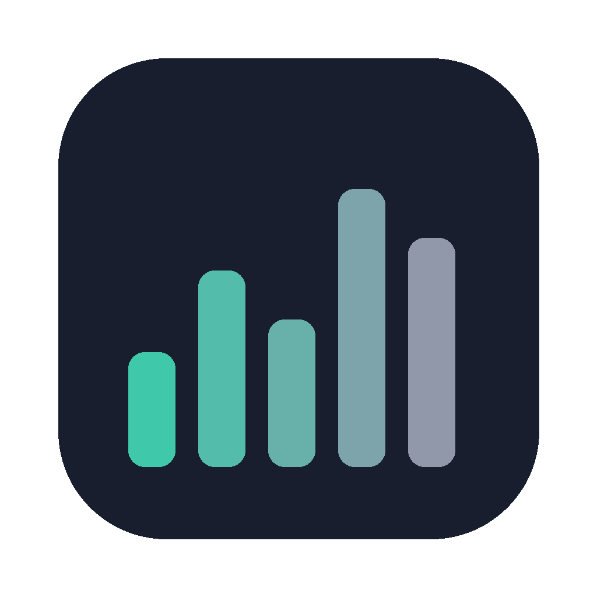

# OptiStats — Apple Silicon Mac System Monitor, Fan Control and Memory Review



**A native macOS menu bar monitor for Apple Silicon.** See CPU, GPU, RAM, temperatures, fans, power, disk, network and battery; review memory-heavy apps; optionally control supported fans and macOS services. Built by [Anglerson](https://github.com/Anglersondev) in Swift and AppKit.

[Download 1.0](https://github.com/Anglersondev/OptiStats/releases/tag/v1.0) · [Features](#what-it-does) · [Compare with Stats](#optistats-and-stats) · [FAQ](#frequently-asked-questions) · [Português brasileiro](README.pt-BR.md) · [Report a bug](https://github.com/Anglersondev/OptiStats/issues)

[](https://github.com/Anglersondev/OptiStats/actions/workflows/ci.yml)

## Release status

| Item | Current status |
| --- | --- |
| Published version | [1.0](https://github.com/Anglersondev/OptiStats/releases/tag/v1.0) |
| Supported Macs | Apple Silicon; macOS 13 or later |
| Fan speeds | Read-only by default; write control requires the optional privileged helper and supported hardware |
| Code signing | Ad-hoc signed; not Apple notarized |
| Validation | [CI builds and core tests](https://github.com/Anglersondev/OptiStats/actions/workflows/ci.yml); physical fan behavior still needs checking on each Mac |

Sensor names, readings and fan write support depend on the model. OptiStats does not promise a temperature or fan control that the hardware does not expose.

## What it does

- Monitor CPU, GPU, RAM, temperatures, power, fans, disk, network and battery from customizable menu bar indicators.
- Open history charts, sensor readings and processes grouped by application.
- Choose Economy, Balanced, Real-time or Custom sampling. Hidden sources stop sampling; collectors share one scheduler.
- Analyze memory pressure and review large apps that have stayed in the background for an hour. Inspired by Dusty: grouped physical footprints, protected apps, normal quit requests and measured results.
- Read fan speeds by default. Optional Automatic, Manual, **100%** and Smart Boost controls use the privileged helper. Manual targets are remembered and reapplied on launch and wake, even with a cold Mac. No beta test step.
- Manage disk/cache maintenance and selected macOS services with optional Debloat tools.
- Switch between English and Brazilian Portuguese at runtime. Find the version, credits and donation link in **Preferences → About**.

## Updated 1.0: fans, temperatures and memory

- Fan acquisition now falls back to `Ftst` when a direct mode write is accepted without taking effect. Automatic explicitly resets every mode and target owned by OptiStats.
- CPU temperatures prefer the firmware die average/maximum (`TCMb` / `TCMz`); implausible CPU/GPU readings are discarded and HID fallback is selected per zone class. Fan updates no longer refresh old temperature timestamps.
- RAM reviews use workspace activity notifications, with no extra polling loop or Dusty runtime dependency. No app is closed automatically; healthy memory stays labelled healthy.
- Version remains **1.0**, helper build **4**. Existing installations must update the helper once in **Preferences → Fans**. Enable **General → Launch at login** to resume saved fan targets after signing in. Choosing Automatic clears them.

## Interface and manual app selection

Native grouped panels, clearer headers and a fixed title for each preferences pane keep navigation consistent. In Memory, **Choose apps → check your selection → Quit selected** works without an idle-time or memory-pressure requirement. Protected apps remain excluded. Memory details expand on request; monitoring frequency is unchanged.

## Download and requirements

[Download OptiStats 1.0 for macOS](https://github.com/Anglersondev/OptiStats/releases/download/v1.0/OptiStats-1.0.dmg). Open the DMG and drag OptiStats to Applications.

Requires **macOS 13 or later and Apple Silicon**. Sensor availability and fan control depend on the Mac. The release is ad-hoc signed, not Apple notarized; macOS may require approval in System Settings → Privacy & Security. Install the optional fan helper only if you want write control.

## Inspired by Stats, with additional tools

OptiStats is an independent app inspired by [Stats by exelban](https://github.com/exelban/stats). Selected SMC, sensor, IOReport and fan-control approaches were studied or adapted with MIT attribution. OptiStats uses its own sampling architecture and adds RAM guidance, disk/cache maintenance and a Debloat interface. It is not affiliated with Stats.

The focus is low overhead: demand-driven collection, shared reads, bounded history and background work away from the interface thread. **Lower CPU or RAM use than Stats has not been established in a controlled comparison.** See [performance measurement](#measure-performance) and [the implementation audit](docs/AUDITORIA-STATS.md).

## OptiStats and Stats

The table describes published features, not measured performance. [Stats](https://github.com/exelban/stats) is an established open-source system monitor; OptiStats is an independent project with a different scope. Features marked “not documented” may exist in another form or change in later releases.

| Need | OptiStats 1.0 | Stats |
| --- | --- | --- |
| Menu bar CPU, GPU, memory, disk, network, sensors and battery | Yes | Yes |
| Fan speed display | Yes, when exposed by the Mac | Yes, when exposed by the Mac |
| Fan write control | Optional Automatic, Manual, 100% and Smart Boost through a privileged helper | Repository lists fan control as not maintained |
| Review and selectively quit large idle apps | Yes, with protected-app exclusions and confirmation | Not documented as a dedicated workflow |
| Optional macOS service/Debloat catalog | Yes, with snapshots and manual confirmation | Not documented as a dedicated workflow |
| Independently measured lower resource use | Not established | No like-for-like benchmark in this repository |

Choose Stats if you want its broader, established monitor and widget ecosystem. Choose OptiStats if its memory review, fan workflow or optional maintenance tools meet your needs. Do not run two fan-control utilities against the same fan at the same time.

## Debloat: source and behavior

The service catalog, comments and presets are based on **[mac-os-debloat by Oleksandr Krupko](https://github.com/OleksandrKrupko/mac-os-debloat)**, licensed under MIT. OptiStats bundles a copy of its `EMBEDDED_LABELS` catalog and implements its own interface and application logic; it does not execute the upstream Python script.

Open Debloat to inspect services present on your Mac, review Telemetry/Balanced/All presets, and confirm selected launchd changes. Snapshots let the app restore supported changes it made. Disabling services can affect features such as iCloud, App Store and macOS updates; the available services vary by macOS version and SIP restrictions still apply. Debloat is optional and does not run continuously.

Catalog updates are **manual**: the button fetches the catalog from the original repository over HTTPS. Monitoring stays local and there is no telemetry. See [third-party notices](THIRD_PARTY_NOTICES.md) for the preserved MIT licenses.

## Build and validation

Use macOS with Xcode 15 or later:

```sh
python3 scripts/generate_xcodeproj.py
xcodebuild -project OptiStats.xcodeproj -scheme OptiStats -configuration Release build CODE_SIGNING_ALLOWED=NO
swift test --package-path Packages/OptiStatsCore
python3 scripts/check_localization.py
```

For a Command Line Tools-only build, run `scripts/build_app.sh`. Simulated SMC and preference regressions run with `scripts/check_hardware_regressions.sh` without administrator privileges or physical SMC writes.

The pure Swift core is tested on Linux and macOS in CI; CI also builds the macOS app and DMG. Automated checks do not validate physical fan response. Fan behavior and resource usage must be checked on the target Mac. The app is not sandboxed because its monitoring and optional control use macOS system interfaces.

## Measure performance

With the app open and the Mac idle, run `scripts/benchmark.sh 300 OptiStats`. Compare identical enabled features and sampling profiles when measuring another monitor. CPU and memory figures are measurements for that configuration, not universal guarantees.

The memory review adapts ideas from [Dusty by Toprak Yagcioglu](https://github.com/yagcioglutoprak/dusty), including reviewing large idle apps instead of promising RAM savings. The implementation stays inside OptiStats; Dusty is not installed or run.

## Credits and support

Created by **Anglerson**. [Support development ☕](https://pixgg.com/Anglerson).

Third-party MIT notices are preserved in [THIRD_PARTY_NOTICES.md](THIRD_PARTY_NOTICES.md). An overall license for OptiStats has not yet been declared; the third-party licenses apply to their respective material.

## Frequently asked questions

### Can OptiStats control the fans on every Apple Silicon Mac?

No. Fan control depends on the model and the SMC interfaces it exposes. Monitoring is read-only by default; install the optional helper only when you need supported write controls. Check the RPM change on your own Mac after applying a setting.

### Does OptiStats automatically close apps to free RAM?

No. It reviews memory pressure and large background apps, protects selected apps, and requires you to choose and confirm any quit action. Healthy memory is shown as healthy.

### Is OptiStats lighter than Stats or Activity Monitor?

That has not been established by a controlled comparison. Its collectors share a scheduler and stop hidden sources, but your enabled modules and sampling profile determine actual usage. Use [the benchmark script](#measure-performance) under comparable settings.

### Is the Debloat feature required for monitoring?

No. It is optional and does not run continuously. Review each proposed service change and its possible effects before confirming it.
